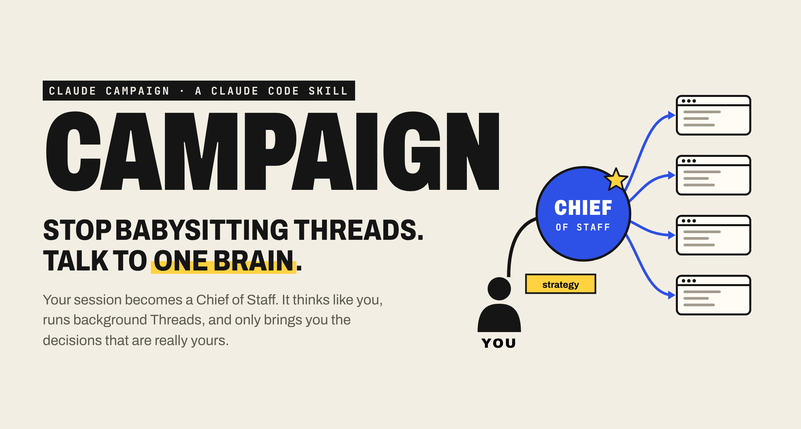
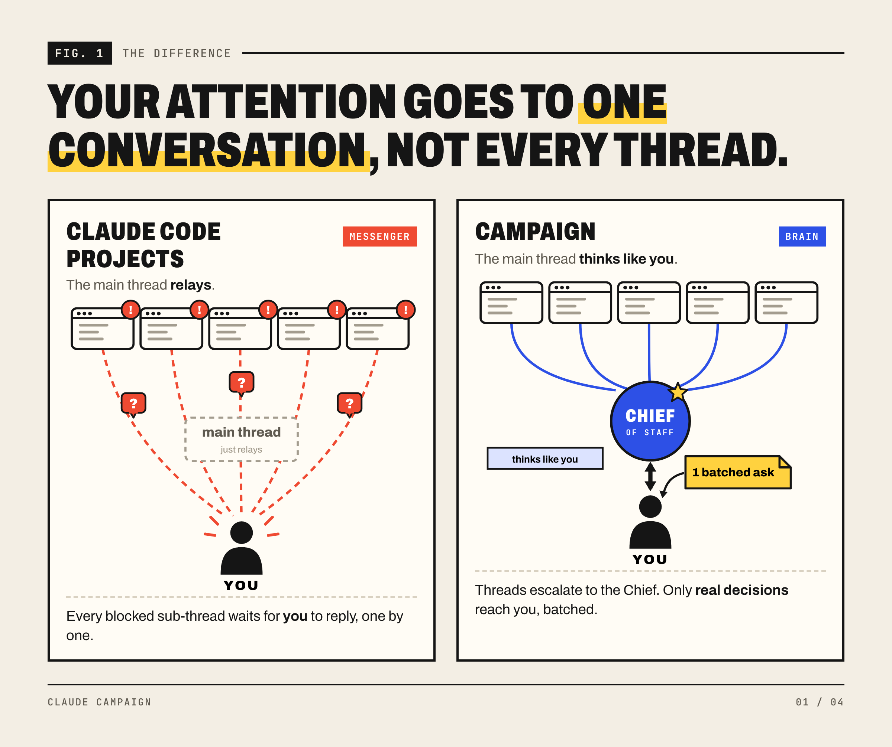
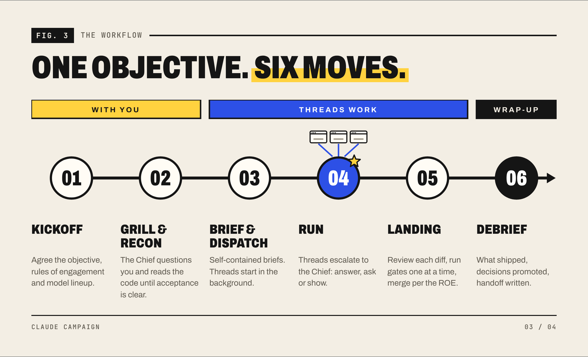
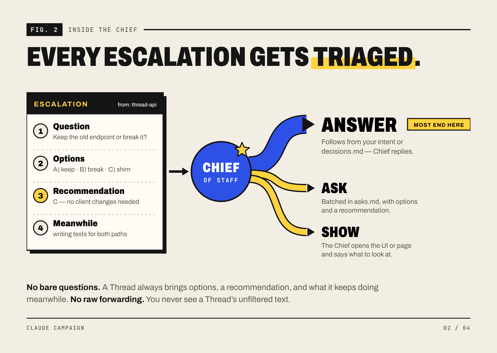
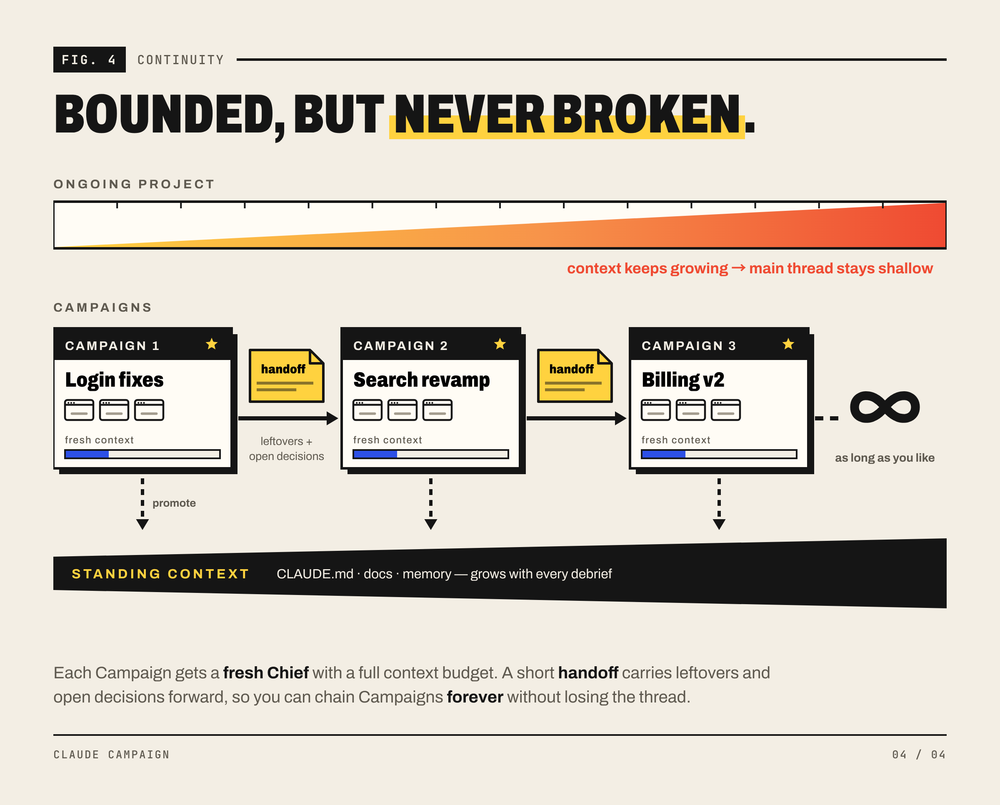
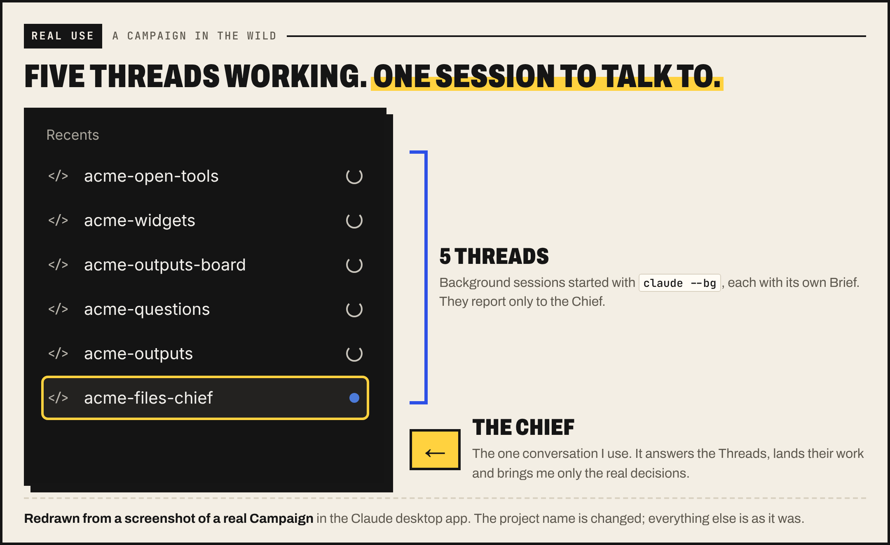
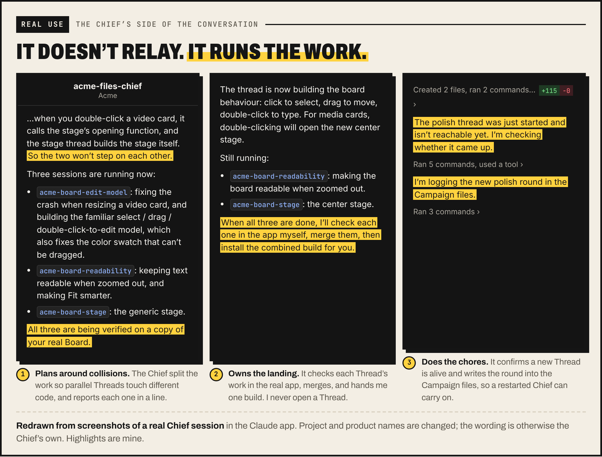
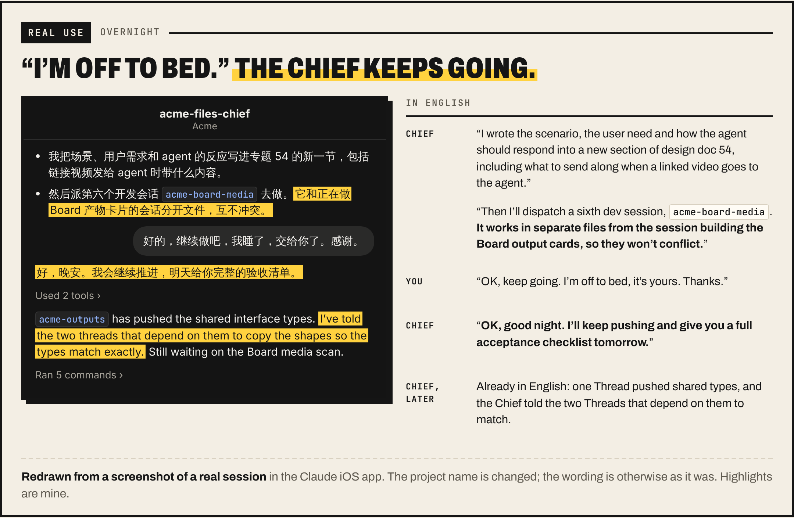
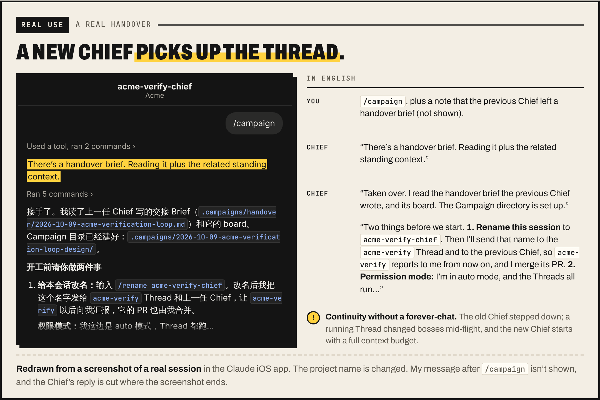

# Claude Campaign

<p align="center"></p>

[中文版](README.zh-CN.md) · MIT licensed

**Claude Campaign** is a pair of skills for Claude Code. Type `/campaign-native <goal>` (Claude desktop app) or `/campaign <goal>` (terminal) and that session becomes your **Chief of Staff**: it plans the work with you, starts Claude Code sessions (**Threads**) to do it in parallel, answers their questions, reviews and merges their results, and writes a debrief at the end.

Threads aren't hidden subagents: each one shows up in the Claude desktop app, on the web and on your phone, and you can step into any of them whenever you want. Think of it as Claude Code Projects, but local, focused on one campaign at a time, and available today. No beta, no waitlist.

## Why

<p align="center"></p>

- **A brain, not a messenger.** In Claude Code Projects, blocked threads wait for you to answer them one by one. In a Campaign, Threads only talk to the Chief, and the Chief answers most questions itself. Only real decisions reach you.
- **One campaign at a time.** A Project runs forever, so its main thread stays shallow. A Campaign has a focused set of objectives and ends with a debrief, so the Chief can go deep.
- **Your machine, your setup.** It runs in the repo you already have, with your `CLAUDE.md`, memory, tools and local apps. Nothing to migrate.

## How it works

<p align="center"></p>

**You talk to the Chief. Threads talk to the Chief.** When a Thread is stuck, it sends the Chief a question, options, a recommendation and what it will do meanwhile. The Chief answers, asks you, or shows you.

<p align="center"></p>

**Bounded, but never broken.** Each Campaign ends with a short handoff: leftover work plus open decisions. Start the next Campaign from it, and a fresh Chief carries on. Chain them for as long as you like.

<p align="center"></p>

## In real use

These are redrawn from real sessions. Project names are changed; the wording is the Chief's own.

<p align="center"></p>

<p align="center"></p>

<p align="center"></p>

<p align="center"></p>

## Two skills, one Campaign

| | `campaign-native` (recommended) | `campaign` |
|---|---|---|
| Runs in | Claude desktop app (Code tab) | Terminal, or the desktop app |
| Threads are | the app's own linked sub-sessions, grouped under the Chief in the sidebar | `claude --bg` sessions with Remote Control |
| Thread reports | arrive by themselves when a Thread ends a turn | `SendMessage` between sessions |
| Moving parts | one setup script, one optional hook | scripts to spawn Threads and hand over, optional guard hooks |

Both keep the Campaign's state in the same files (`.campaigns/<date>-<slug>/`), so a Chief of either kind can take over a Campaign the other started. `tools/check-shared.sh` keeps that contract honest.

## Install

```sh
git clone https://github.com/yammaku/claude-campaign-skill.git
cd claude-campaign-skill

mkdir -p "$HOME/.claude/skills"
for skill in campaign-native campaign; do
  target="$HOME/.claude/skills/$skill"
  if [ -e "$target" ] || [ -L "$target" ]; then
    echo "$skill already exists; back it up or remove it first." >&2
  else
    cp -R "./$skill" "$target"
  fi
done
```

Install just one of them if you like; each works on its own. Open a new Claude Code session and type `/campaign-native` or `/campaign` to check it's there. To update later, `git pull` and copy again.

**Requirements.** `campaign-native` needs the Claude desktop app with sub-sessions (`start_session`). `campaign` needs a logged-in Claude Code with background sessions (`--bg`), `--worktree`, `--remote-control` and cross-session `SendMessage`; it was tested on Claude Code 2.1.294. Both were tested on macOS.

**Hooks (optional, once per machine).** They go into `~/.claude/settings.json`.
- `campaign-native`: a SessionStart hook that reads the Campaign's resume card back to the Chief after a compaction. The snippet is at the end of [campaign-native/SKILL.md](campaign-native/SKILL.md).
- `campaign`: the chief-guard hooks, which refuse a heavy step (merge, push, spawn) until the resume card is up to date. See [campaign/references/chief-guard.md](campaign/references/chief-guard.md).

## Use

```text
/campaign-native Fix the three login-flow bugs and finish regression testing
/campaign-native resume <campaign-dir>
/campaign Fix the three login-flow bugs and finish regression testing
/campaign resume <slug>
```

Before you start:

- **Permissions.** With `campaign-native`, a Thread's permission mode and effort can't exceed the Chief's, so start the Chief in the mode you want the Threads to have. With `campaign`, Threads run with `--permission-mode bypassPermissions`, and the Chief should use the same mode, or messages between them wait for approval. Use bypass only in repos where that's fine.
- **Remote Control.** With `campaign-native`, turn on Settings → Claude Code → "Connect new sessions to Remote Control" to follow Threads on the web and your phone. With `campaign` it is on by default; ask the Chief for `--no-remote-control` to turn it off.
- **Usage.** Threads use your normal Claude plan. For small tasks the Chief just does the work itself.

## What's inside

```text
campaign-native/
├── SKILL.md                   The Chief's workflow and rules (desktop sub-sessions)
├── scripts/
│   ├── chief.sh               Creates or resumes .campaigns/<date>-<slug>/ and registers the Chief
│   └── resume-inject.py       Optional hook: the resume card after a compaction
└── references/
    ├── brief-template.md      A Thread's task brief, including how it reports
    └── campaign-file.md       The shared Campaign file layout
campaign/
├── SKILL.md                   The Chief's workflow and rules (claude --bg)
├── scripts/
│   ├── campaign-init.sh       Creates .campaigns/<date>-<slug>/
│   ├── spawn-thread.sh        Starts a Thread with claude --bg
│   ├── handover-chief.sh      Starts a new Chief when you ask for a handover
│   ├── chief-register.sh      Registers the Chief for the guard hooks
│   └── chief-guard.py         Optional hooks that keep the resume card current
└── references/
    ├── brief-template.md      A Thread's task brief
    ├── campaign-file.md       The shared Campaign file layout (same as above)
    ├── thread-protocol.md     How Threads report and escalate
    ├── handover-template.md   What an outgoing Chief writes down
    └── chief-guard.md         What the guard hooks do and how to install them
tools/
└── check-shared.sh            Checks that both skills still share one Campaign file
```

Campaign state lives in `.campaigns/` inside your repo and is kept out of git through `.git/info/exclude`.

## License

[MIT](LICENSE). Use it, change it, share it.
