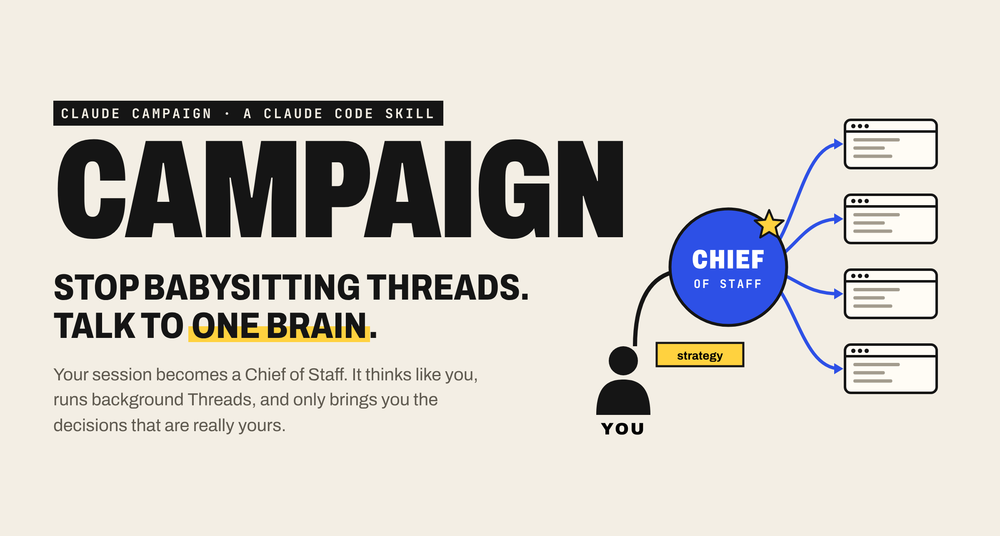
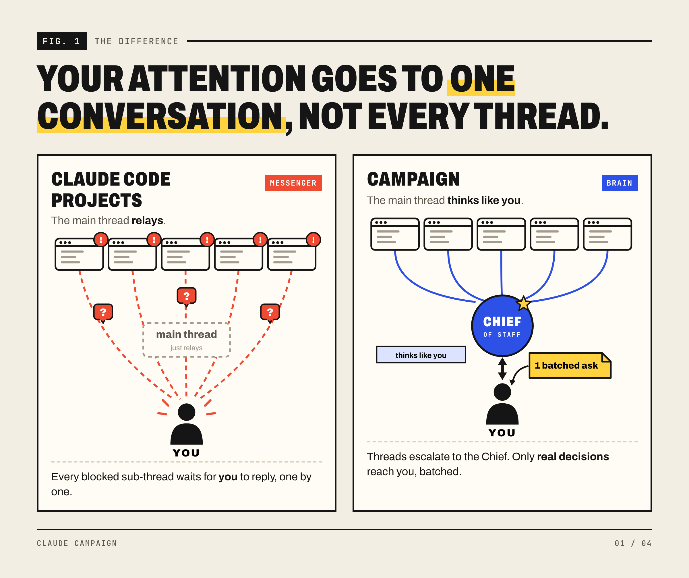
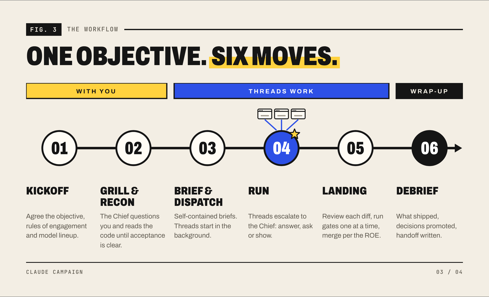
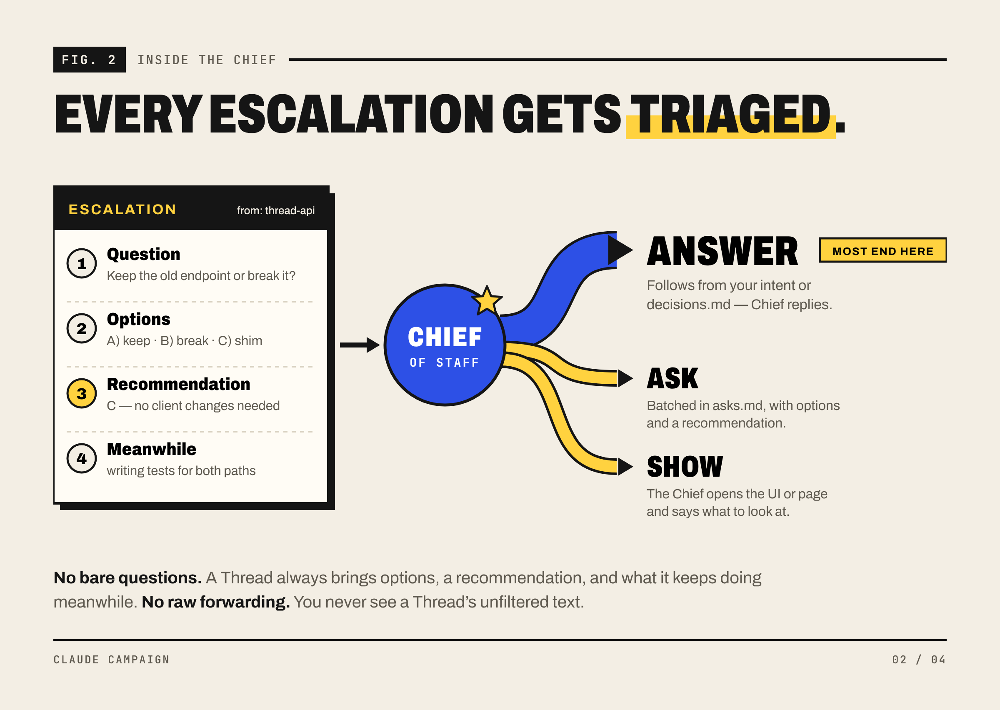
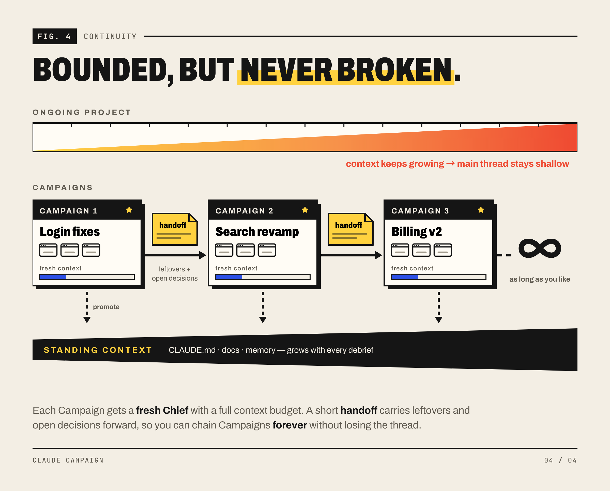

# Claude Campaign

<p align="center"></p>

[中文版](README.zh-CN.md) · MIT licensed

**Claude Campaign** is a skill for Claude Code. Type `/campaign <goal>` and that session becomes your **Chief of Staff**: it plans the work with you, starts background Claude Code sessions (**Threads**) to do it in parallel, answers their questions, reviews and merges their results, and writes a debrief at the end.

Think of it as Claude Code Projects, but local, focused on one campaign at a time, and available today. No beta, no waitlist.

## Why

<p align="center"></p>

- **A brain, not a messenger.** In Claude Code Projects, blocked threads wait for you to answer them one by one. In a Campaign, Threads only talk to the Chief, and the Chief answers most questions itself. Only real decisions reach you.
- **One campaign at a time.** A Project runs forever, so its main thread stays shallow. A Campaign has a focused set of objectives and ends with a debrief, so the Chief can go deep.
- **Your machine, your setup.** It runs in the repo you already have, with your `CLAUDE.md`, memory, tools and local apps. Nothing to migrate.

## How it works

<p align="center"></p>

**You talk to the Chief. Threads talk to the Chief.** When a Thread is stuck, it sends the Chief a question, options, a recommendation and what it will do meanwhile. The Chief answers, asks you, or shows you.

<p align="center"></p>

**Bounded, but never broken.** Each Campaign ends with a short handoff: leftover work plus open decisions. Start the next Campaign from it, and a fresh Chief carries on. Chain them for as long as you like.

<p align="center"></p>

## In real use

These are redrawn from real sessions. Project names are changed; the wording is the Chief's own.

<p align="center"></p>

<p align="center"></p>

<p align="center"></p>

<p align="center"></p>

## Install

Requires a logged-in Claude Code with background sessions (`--bg`), `--worktree`, `--remote-control` and cross-session `SendMessage`. Tested on Claude Code 2.1.294, macOS.

```sh
git clone https://github.com/yammaku/claude-campaign-skill.git
cd claude-campaign-skill

campaign_target="$HOME/.claude/skills/campaign"
if [ -e "$campaign_target" ] || [ -L "$campaign_target" ]; then
  echo "campaign already exists; back it up or remove it first." >&2
else
  mkdir -p "$HOME/.claude/skills"
  cp -R ./campaign "$campaign_target"
fi
```

Open a new Claude Code session and type `/campaign` to check it's there.

## Use

```text
/campaign Fix the three login-flow bugs and finish regression testing
/campaign resume <slug>
```

Before you start:

- **Permissions.** Threads run with `--permission-mode bypassPermissions`, and the Chief should use the same mode, or messages between them wait for approval. Use it only in repos where that's fine.
- **Remote Control** is on by default, so you can open any Thread from the Claude desktop app, web or phone. Ask the Chief for `--no-remote-control` to turn it off.
- **Usage.** Background sessions use your normal Claude plan. For small tasks the Chief just does the work itself.

## What's inside

```text
campaign/
├── SKILL.md                   The Chief's workflow and rules
├── scripts/
│   ├── campaign-init.sh       Creates .campaigns/<date>-<slug>/
│   └── spawn-thread.sh        Starts a Thread with claude --bg
└── references/
    ├── brief-template.md      A Thread's task brief
    ├── campaign-file.md       Board, decisions, asks, handoff
    └── thread-protocol.md     How Threads report and escalate
```

Campaign state lives in `.campaigns/` inside your repo and is kept out of git through `.git/info/exclude`.

## License

[MIT](LICENSE). Use it, change it, share it.
