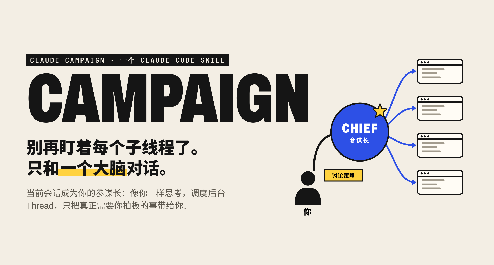
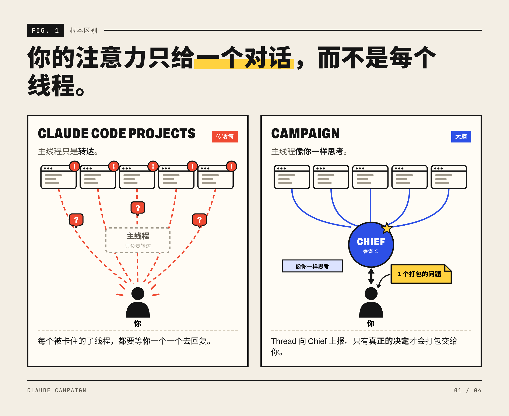
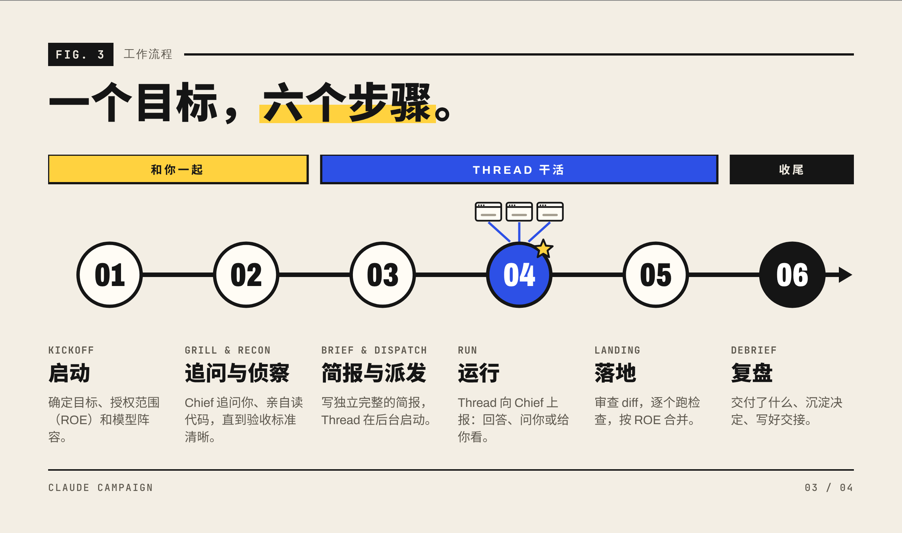
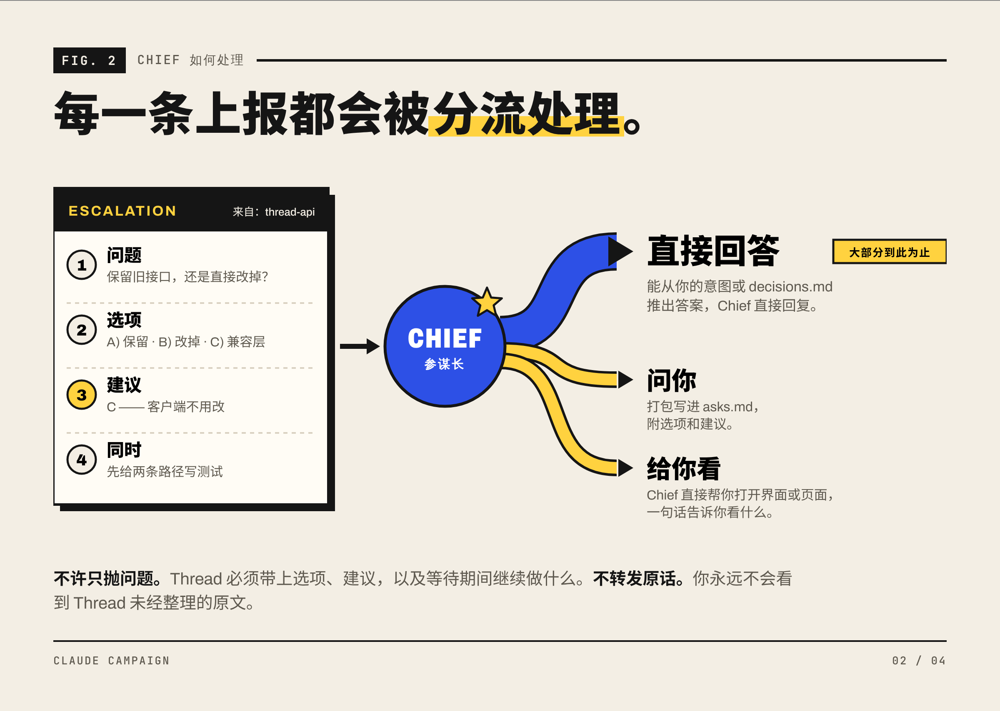
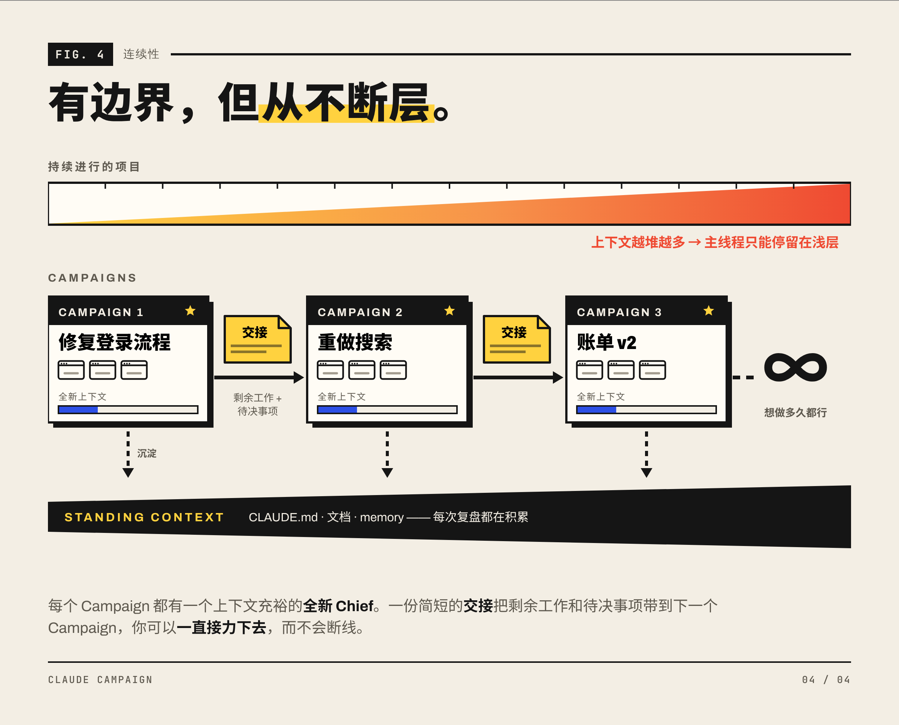
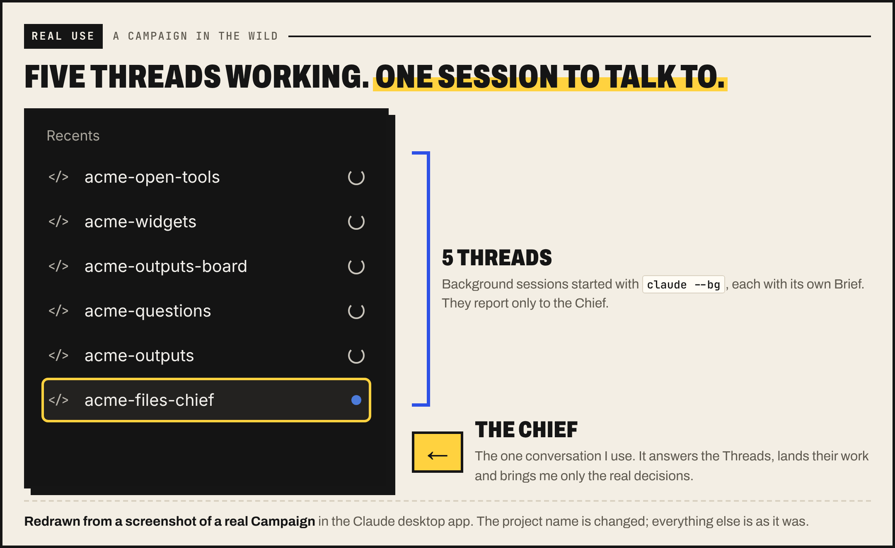
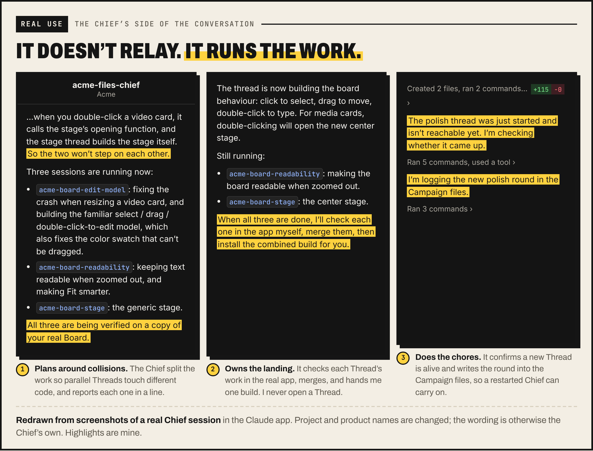
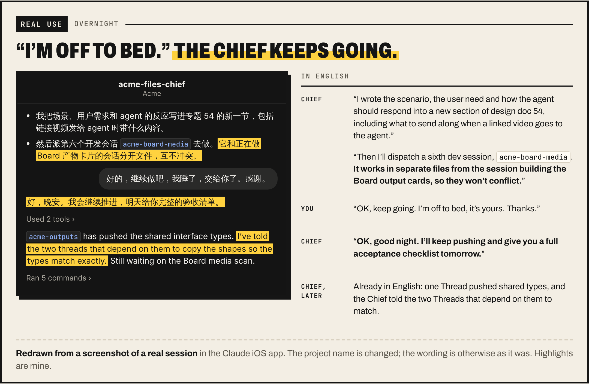
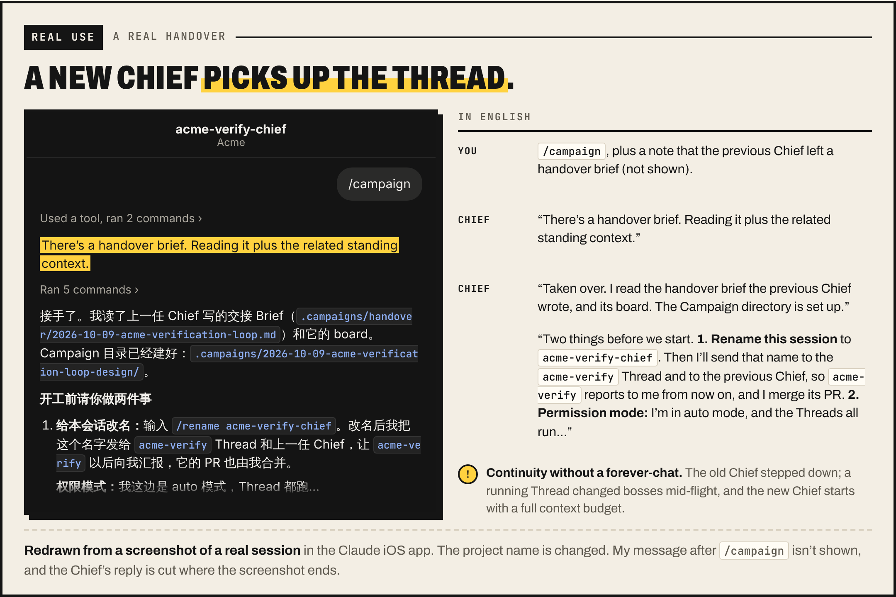

# Claude Campaign

<p align="center"></p>

[English](README.md) · MIT 许可证

**Claude Campaign** 是一对 Claude Code skill。输入 `/campaign-native <目标>`（Claude 桌面端）或 `/campaign <目标>`（终端），当前会话就成为你的**参谋长（Chief）**：和你一起把事情想清楚，启动多个 Claude Code 会话（**Thread**）并行干活，回答它们的问题，审查并合并它们的成果，最后写复盘。

Thread 不是藏起来的 subagent：每一个都会出现在 Claude 桌面端、网页和手机上，你随时可以点进去直接介入。可以把它理解成 Claude Code Projects 的本地版：一次只专注一场 Campaign，现在就能用，不用等 beta、不用排队。

## 为什么

<p align="center"></p>

- **是大脑，不是传话筒。** 在 Claude Code Projects 里，卡住的子线程要你一个一个去回复。在 Campaign 里，Thread 只和 Chief 说话，大部分问题 Chief 自己就能回答，只有真正的决定才会交给你。
- **一次一场 Campaign。** Project 永远不结束，主线程只能停留在浅层。Campaign 有一组聚焦的目标，做完就复盘，所以 Chief 可以深入。
- **你的电脑，你的环境。** 直接在你已有的仓库里运行，用你的 `CLAUDE.md`、memory、工具和本地应用，不需要任何迁移。

## 工作方式

<p align="center"></p>

**你只和 Chief 说话，Thread 也只和 Chief 说话。** Thread 卡住时，会带着问题、选项、建议，以及等待期间继续做什么，上报给 Chief。Chief 要么直接回答，要么问你，要么打开给你看。

<p align="center"></p>

**有边界，但不断层。** 每个 Campaign 结束时都会写一份简短的交接：剩余工作和待决事项。下一个 Campaign 从交接开始，由全新的 Chief 接着做，想接力多久都行。

<p align="center"></p>

## 真实使用

以下图片根据真实会话重画，项目名已更改，其余都是 Chief 的原话。

<p align="center"></p>

<p align="center"></p>

<p align="center"></p>

<p align="center"></p>

## 两个 skill，同一场 Campaign

| | `campaign-native`（推荐） | `campaign` |
|---|---|---|
| 运行环境 | Claude 桌面端（Code 标签页） | 终端，或桌面端 |
| Thread 是什么 | 桌面端自带的关联子会话，在侧边栏里归在 Chief 下面 | 开了 Remote Control 的 `claude --bg` 会话 |
| Thread 怎么汇报 | Thread 每轮结束时，汇报自动送到 Chief | 会话之间用 `SendMessage` |
| 组成 | 一个初始化脚本，一个可选的钩子 | 启动 Thread、交接 Chief 的脚本，可选的守护钩子 |

两者把 Campaign 的状态存在同一套文件里（`.campaigns/<日期>-<名称>/`），所以任何一种 Chief 都能接手另一种开的 Campaign。`tools/check-shared.sh` 负责检查这一点没有被改坏。

## 安装

```sh
git clone https://github.com/yammaku/claude-campaign-skill.git
cd claude-campaign-skill

mkdir -p "$HOME/.claude/skills"
for skill in campaign-native campaign; do
  target="$HOME/.claude/skills/$skill"
  if [ -e "$target" ] || [ -L "$target" ]; then
    echo "$skill 已存在，请先备份或移除旧版本。" >&2
  else
    cp -R "./$skill" "$target"
  fi
done
```

只装其中一个也可以，两个各自都能独立使用。打开一个新的 Claude Code 会话，输入 `/campaign-native` 或 `/campaign` 确认能识别。以后更新时 `git pull`，再复制一次。

**环境要求。** `campaign-native` 需要支持子会话（`start_session`）的 Claude 桌面端。`campaign` 需要已登录的 Claude Code，支持后台会话（`--bg`）、`--worktree`、`--remote-control` 和跨会话 `SendMessage`，已在 Claude Code 2.1.294 上验证。两者都在 macOS 上验证过。

**钩子（可选，每台电脑装一次）。** 加在 `~/.claude/settings.json` 里。
- `campaign-native`：一个 SessionStart 钩子，上下文压缩后把 Campaign 的进度卡读回给 Chief。配置片段在 [campaign-native/SKILL.md](campaign-native/SKILL.md) 末尾。
- `campaign`：chief-guard 钩子，进度卡没更新时拒绝合并、推送、启动 Thread 这类重操作。见 [campaign/references/chief-guard.md](campaign/references/chief-guard.md)。

## 使用

```text
/campaign-native 修复登录流程的三个问题，并完成回归验证
/campaign-native resume <campaign 目录>
/campaign 修复登录流程的三个问题，并完成回归验证
/campaign resume <名称>
```

开始之前：

- **权限。** 用 `campaign-native` 时，Thread 的权限模式和 effort 不能高于 Chief，所以 Chief 要以你希望 Thread 使用的模式启动。用 `campaign` 时，Thread 以 `--permission-mode bypassPermissions` 运行，Chief 也应该用同样的模式，否则它们之间的消息会卡在等待批准。bypass 只在你能接受的仓库里用。
- **Remote Control。** 用 `campaign-native` 时，打开 设置 → Claude Code →「Connect new sessions to Remote Control」，就能在网页和手机上跟进 Thread。用 `campaign` 时默认开启，不需要的话让 Chief 加上 `--no-remote-control`。
- **用量。** Thread 会正常消耗你的 Claude 额度。任务很小时，Chief 会自己直接做。

## 包含的文件

```text
campaign-native/
├── SKILL.md                   Chief 的流程和规则（桌面端子会话）
├── scripts/
│   ├── chief.sh               创建或恢复 .campaigns/<日期>-<名称>/，并登记 Chief
│   └── resume-inject.py       可选钩子：压缩后读回进度卡
└── references/
    ├── brief-template.md      Thread 的任务简报模板，含汇报方式
    └── campaign-file.md       两个 skill 共用的 Campaign 文件格式
campaign/
├── SKILL.md                   Chief 的流程和规则（claude --bg）
├── scripts/
│   ├── campaign-init.sh       创建 .campaigns/<日期>-<名称>/
│   ├── spawn-thread.sh        用 claude --bg 启动 Thread
│   ├── handover-chief.sh      你要求交接时，启动新的 Chief
│   ├── chief-register.sh      为守护钩子登记 Chief
│   └── chief-guard.py         可选钩子：保证进度卡始终是最新的
└── references/
    ├── brief-template.md      Thread 的任务简报模板
    ├── campaign-file.md       共用的 Campaign 文件格式（与上面相同）
    ├── thread-protocol.md     Thread 如何汇报和上报
    ├── handover-template.md   交出去的 Chief 要写下什么
    └── chief-guard.md         守护钩子做什么、怎么安装
tools/
└── check-shared.sh            检查两个 skill 是否仍共用同一套 Campaign 文件
```

Campaign 的状态保存在仓库里的 `.campaigns/` 中，并通过 `.git/info/exclude` 排除在 git 之外。

## 许可证

[MIT](LICENSE)：随便用，随便改，随便分享。
