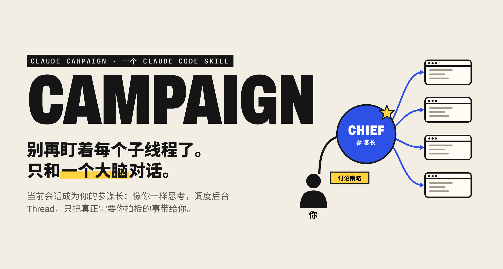
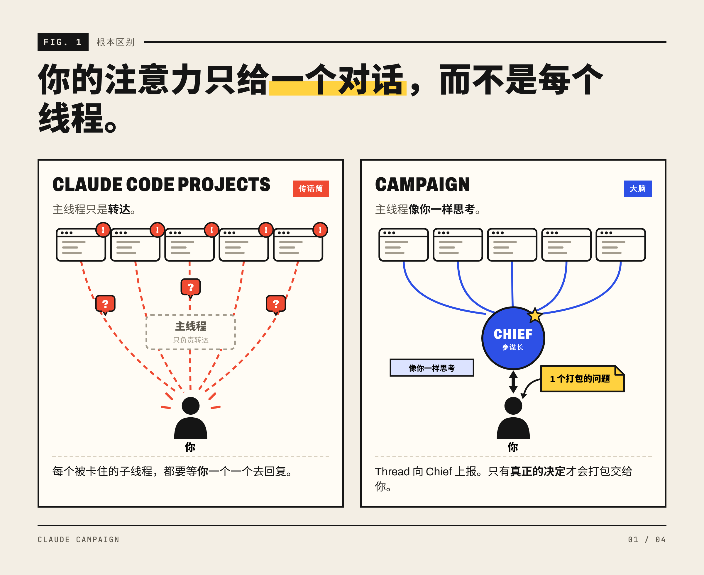
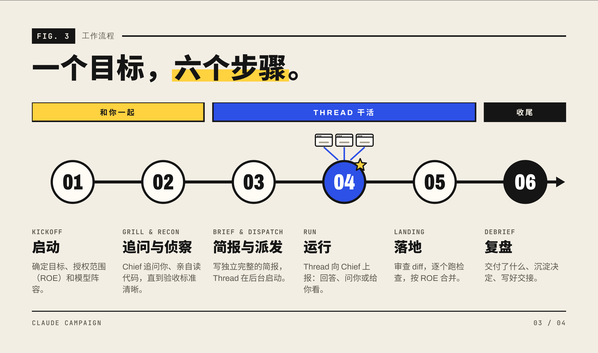
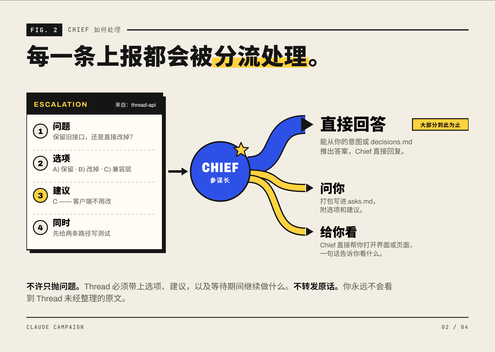
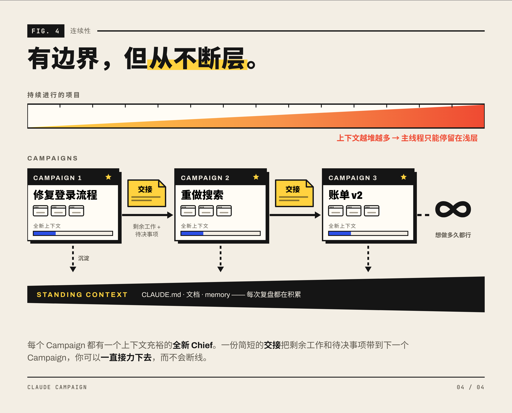
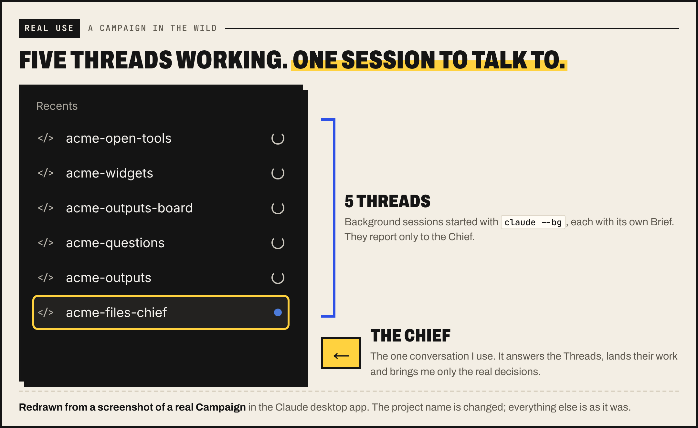
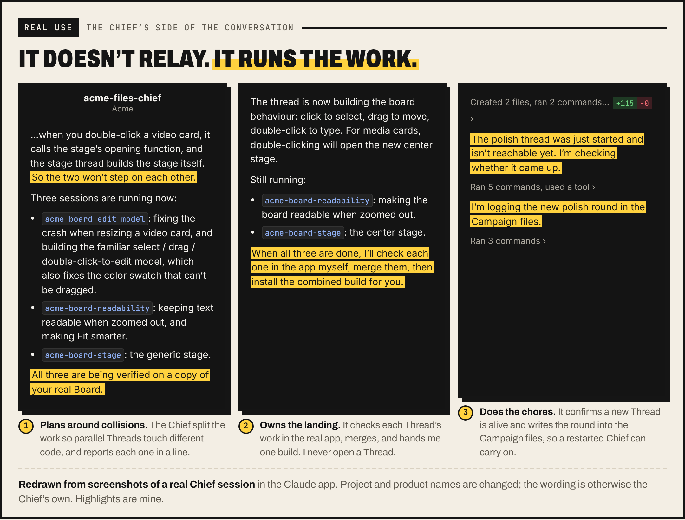
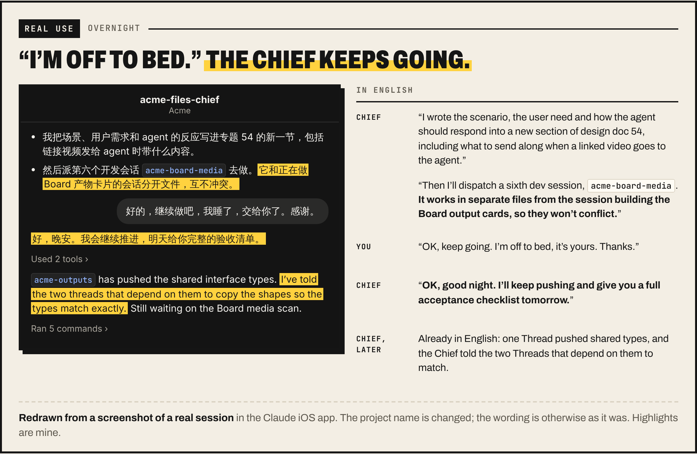
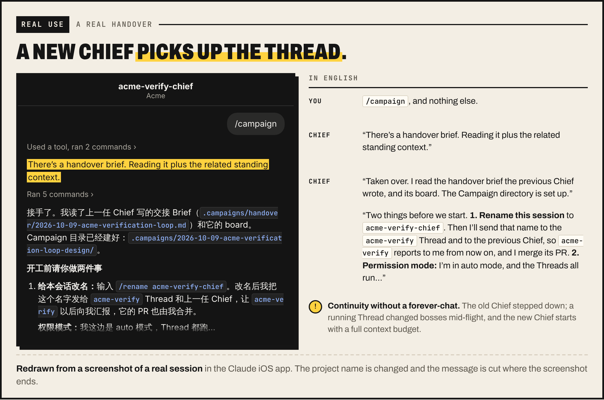

# Claude Campaign

<p align="center"></p>

[English](README.md) · MIT 许可证

**Claude Campaign** 是一个 Claude Code skill。输入 `/campaign <目标>`，当前会话就成为你的**参谋长（Chief）**：和你一起把事情想清楚，启动多个后台 Claude Code 会话（**Thread**）并行干活，回答它们的问题，审查并合并它们的成果，最后写复盘。

可以把它理解成 Claude Code Projects 的本地版：一次只专注一个目标，现在就能用，不用等 beta、不用排队。

## 为什么

<p align="center"></p>

- **是大脑，不是传话筒。** 在 Claude Code Projects 里，卡住的子线程要你一个一个去回复。在 Campaign 里，Thread 只和 Chief 说话，大部分问题 Chief 自己就能回答，只有真正的决定才会交给你。
- **一次一个目标。** Project 永远不结束，主线程只能停留在浅层。Campaign 只有一个目标，做完就复盘，所以 Chief 可以深入。
- **你的电脑，你的环境。** 直接在你已有的仓库里运行，用你的 `CLAUDE.md`、memory、工具和本地应用，不需要任何迁移。

## 工作方式

<p align="center"></p>

**你只和 Chief 说话，Thread 也只和 Chief 说话。** Thread 卡住时，会带着问题、选项、建议，以及等待期间继续做什么，上报给 Chief。Chief 要么直接回答，要么问你，要么打开给你看。

<p align="center"></p>

**有边界，但不断层。** 每个 Campaign 结束时都会写一份简短的交接：剩余工作和待决事项。下一个 Campaign 从交接开始，由全新的 Chief 接着做，想接力多久都行。

<p align="center"></p>

## 真实使用

以下图片根据真实会话重画，项目名已更改，其余都是 Chief 的原话。

<p align="center"></p>

<p align="center"></p>

<p align="center"></p>

<p align="center"></p>

## 安装

需要已登录的 Claude Code，支持后台会话（`--bg`）、`--worktree`、`--remote-control` 和跨会话 `SendMessage`。已在 Claude Code 2.1.294、macOS 上验证。

```sh
git clone https://github.com/yammaku/claude-campaign-skill.git
cd claude-campaign-skill

campaign_target="$HOME/.claude/skills/campaign"
if [ -e "$campaign_target" ] || [ -L "$campaign_target" ]; then
  echo "campaign 已存在，请先备份或移除旧版本。" >&2
else
  mkdir -p "$HOME/.claude/skills"
  cp -R ./campaign "$campaign_target"
fi
```

打开一个新的 Claude Code 会话，输入 `/campaign` 确认能识别。

## 使用

```text
/campaign 修复登录流程的三个问题，并完成回归验证
/campaign resume <名称>
```

开始之前：

- **权限。** Thread 以 `--permission-mode bypassPermissions` 运行，Chief 也应该用同样的模式，否则它们之间的消息会卡在等待批准。只在你能接受这种模式的仓库里使用。
- **Remote Control** 默认开启，你可以在 Claude 桌面端、网页或手机上打开任何一个 Thread。不需要的话，让 Chief 加上 `--no-remote-control`。
- **用量。** 后台会话会正常消耗你的 Claude 额度。任务很小时，Chief 会自己直接做。

## 包含的文件

```text
campaign/
├── SKILL.md                   Chief 的流程和规则
├── scripts/
│   ├── campaign-init.sh       创建 .campaigns/<日期>-<名称>/
│   └── spawn-thread.sh        用 claude --bg 启动 Thread
└── references/
    ├── brief-template.md      Thread 的任务简报模板
    ├── campaign-file.md       看板、决定、待问事项、交接
    └── thread-protocol.md     Thread 如何汇报和上报
```

Campaign 的状态保存在仓库里的 `.campaigns/` 中，并通过 `.git/info/exclude` 排除在 git 之外。

## 许可证

[MIT](LICENSE)：随便用，随便改，随便分享。
